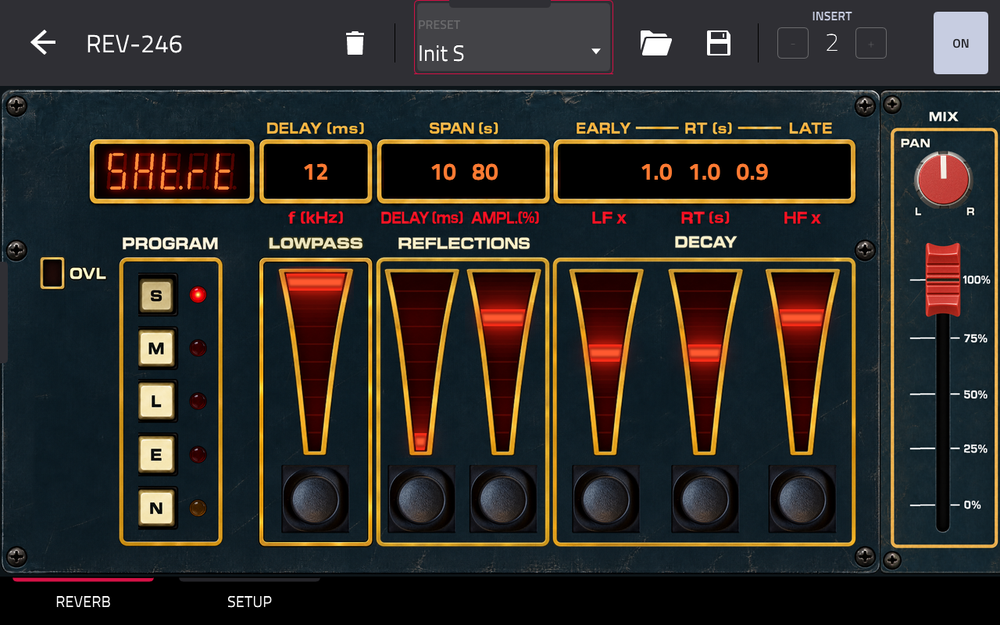
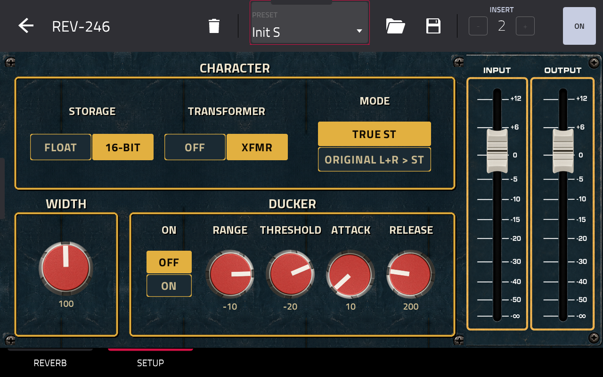

# REV-246 for MPC OS

A port of [REV-246](https://github.com/tehguitarist/REV-246) (tehguitarist, AGPL-3.0), a vintage digital reverb in
the spirit of a mid-80s studio unit, to Akai MPC OS standalone devices as a VST2 insert effect, built on the
[Open MPC](https://github.com/open-mpc/mpc-vst-plugins) wrapper. Not affiliated with the upstream author or with Akai.

- Gen1 (armv7: Live, Live II, One, X, Key 61/37, Force) and Gen2 (aarch64) builds.
- Upstream's reverb engine (`upstream/plugin/src/dsp`, with a few headers sped up for the device in `src/opt`; see
  `VENDORED.md`): the five programmes S / M / L / E / N, 16-bit storage and analogue hiss, XFMR, the ducker, WIDTH.
  MODE: TRUE ST (default: one engine per input side, the dry keeps its channels) or ORIGINAL L+R > ST (upstream's
  original path: the input summed to the unit's mono input, half the CPU).
- Two pages. **REVERB**: programme, the six levers (LOWPASS, DELAY, AMPL, LF x, RT, HF x; in N they read DELAY, SPAN,
  EARLY RT and LATE RT, and RT is unused), MIX, PAN, the OVL light (a 0 dBFS clip light; upstream's LEVEL LEDs are
  left out). **SETUP**: input, output, FLOAT / 16-BIT, XFMR, MODE, width, ducker. All on Q-Links. Upstream's CAL is
  removed: the modelled A/D's full scale is fixed at 0 dBFS.
- 70 presets in MPC's PRESET menu (upstream's factory list).

| REVERB | SETUP |
|---|---|
|  |  |

(On an MPC Live, MPC OS 3.10.1.)

## Install
Download the zip for your MPC from [Releases](../../releases): `-mpc-armv7` for Gen1 (Live, Live II, One, X, Key 61/37,
Force), `-mpc-aarch64` for Gen2.

- **MPC OS 3.10.1 and later** (Preferences, Enhancements, VST2 Support on): copy the folder
  `portable/OpenMPC - VST - REV-246/` from the zip into `VST2 Plugins/` at the root of a drive (on a Gen1 internal
  drive: `/sdcard/VST2 Plugins/`), then restart MPC. Or, as root, `sh install.sh` from the unzipped folder: on 3.10.1
  and later it installs into `VST2 Plugins` by itself.
- **Earlier MPC OS** (root needed): `sh install.sh` from the unzipped folder; see the zip's `INSTALL.md`.

Then add **REV-246** to a track from the plugin browser (insert effects).

## CPU
Open MPC's `tools/bench.sh` on an MPC Live (Gen1, RK3288, MPC OS 3.10.1, 2026-11-22), share of one core per
128-frame block:

| Stage | mean | p99 | worst block |
|---|---|---|---|
| idle / audio, ORIGINAL | 7.9 % | 9.4 % | 11.5 % |
| idle / audio, TRUE ST | 12.0 % | 14.1 % | 17.1 % |
| Q-Link sweep (random values, MODE included) | 15.2 % | 28.5 % | 34.4 % |

Verdict WARN (2026-11-22, with MODE), from the sweep only: at rest both modes are within PASS (TRUE ST was 14.4 % mean /
17.0 % p99 before each engine skipped its unused side, VENDORED.md). The sweep's p99 comes
from MODE switching several times a second (each switch to TRUE ST resets the second engine); turning the levers
alone cost 14.4 % p99 in ORIGINAL before MODE existed.

## Build and test
Needs Docker with arm/arm64 emulation (WSL) and a checkout of `open-mpc/mpc-vst-plugins` next to this repo:
```
../mpc-vst-plugins/tools/build_port.sh vst/vst.json all     # vst/build/ (armv7) and vst/build/aarch64/
../mpc-vst-plugins/tools/test_port.sh vst/vst.json          # host test under ASan/UBSan
../mpc-vst-plugins/tools/bench.sh vst/build/rev246.so <ip>  # CPU on the device (nothing installed)
I="-Isrc/shim -Isrc/opt -Iupstream/plugin/src -I../mpc-vst-plugins/wrapper"
g++ -std=gnu++17 -O2 $I tests/ir_check.cpp src/engine.cpp -o tests/out/ir_check && tests/out/ir_check   # RT, OVL
python3 tools/make_presets.py                               # vst/presets.json from FactoryPresets.h
```
On the device (static armv7 builds copied to `/tmp`): `tests/profile.cpp` (per case), `tests/micro.cpp` (per stage),
`tests/spikes.cpp` (reset and coefficient costs), and `tests/render.cpp` built twice (without `-Isrc/opt`: upstream's
exact engine) with `tests/null_cmp.cpp` to compare them.

## Status (2026-11-22)
Host test PASSED; every programme's measured T20 is within 10 % of the panel RT and OVL lights at 0 dBFS
(`tests/ir_check.cpp`); bench at rest PASS on an MPC Live (Gen1). Installed on that device (MPC OS 3.10.1, in
`/sdcard/VST2 Plugins`), loaded as an insert. Gen2: built and host-tested only.

## Licence
AGPL-3.0, as upstream (`LICENSE`). Source of every release: this repository at the release tag.
